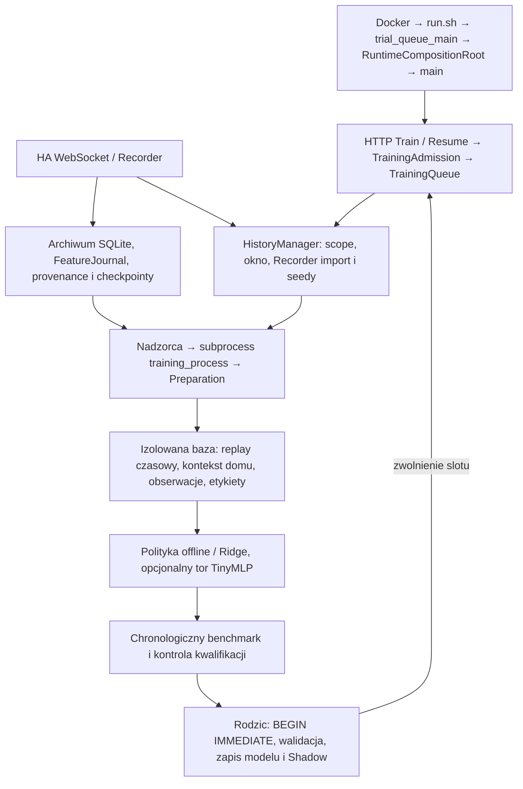

# Audyt treningu Adaptive AI

## Baza i zakres

Stan refs z 19.11.2026. `origin/main` wskazuje `91c7343324d38a1922bfed6486b4ef6dd7a3ba06`, manifest 0.14.184. Punktem odniesienia jest `origin/codex/training-0.15.15` na `e2991ecdbf744572e0f80d9a3db74d55b789064e`, 299 commitów za wspólnym przodkiem, bez commitów wyłącznie po stronie main. Roboczy worktree bazuje bezpośrednio na 0.15.15. Powiązane otwarte PR #374–378 obejmują gałęzie 0.15.5–0.15.9, a #349–369 etapy Universal. Obecność kodu z tych etapów zweryfikowano w historii i kompozycji gałęzi treningowej.

| Wersja | HEAD | Potwierdzona zmiana |
| --- | --- | --- |
| 0.15.6 | `1dcaf02b` | Generacja izolowana, odzysk czytelnych stron, atomowa publikacja. |
| 0.15.7 | `01c3bd76` | Kopiowanie selekcji i checkpoint partii. Długi czytelnik trzymał WAL. |
| 0.15.8 | `bc60087a` | Granica rowid/czas, krótkie odczyty źródła, trwały deskryptor retry i fingerprint modeli. |
| 0.15.9 | `a5596843` | Nawiasy w predykacie keyset, warunek postępu kursora, pomiary kosztu Recorder. |
| 0.15.10 | `589e0b21` | Oddzielny limit normalnej generacji i odzysku, ograniczony read-ahead. |
| 0.15.11 | `83ce27e1` | Postęp VM dla indeksów i quick_check, odzyskanie porzuconego przygotowania. |
| 0.15.12 | `e6ec33d3` | Wersje per encja, grupowane commity scratch WAL, koordynacja retencji archiwum. |
| 0.15.13 | `0564ce8b` | Siedem dni, pojedynczy seed, provenance targetu, mapowanie luk. |
| 0.15.14 | `56a18f18` | Ograniczone retry SQLITE_BUSY w przygotowaniu i publikacji. |
| 0.15.15 | `e2991ecd` | Liczniki rekordu i kursora w przygotowaniu, osobny postęp indeksacji. |

Linia 0.14.x zawiera m.in. izolowany proces i budżet pracy, cache sesji, indeks RAM, ponowne użycie statystyk między chunkami oraz ograniczenie kosztu importu i zapisów archiwum. Port U01–U04c na 0.14.232 jest w `2ed401aa`. Linia treningowa zawiera późniejsze zmiany U05 oraz diagnostykę Recorder 0.14.235–0.14.240.

## Ścieżka wykonywana przez dodatek

`trial_queue_main.py` importuje `preference_queue_main → fast_queue_main → queue_main → main`, wiąże finalną kompozycję i instaluje guardy startu oraz UI. Świeża sesja `HistoryManager._run_agent_indexing` najpierw kwalifikuje/importuje historię Recorder. Odtwarzalny deskryptor odroczonego przygotowania może ominąć ten import po restarcie. Dopiero etap izolacji rejestruje granicę źródła. `Preparation.run` zatwierdza krótką transakcję capture i kopiuje małymi stronami bez utrzymywania czytelnika między batchami. Kursor i kopia są w tej samej transakcji scratch. Po zakończeniu child zmienia wszystkie czytniki na tę samą izolowaną bazę. `publish_generation` waliduje źródło i publikuje politykę, doświadczenia, benchmark i stan agenta w jednej transakcji.

| Etap | Koszt i zasób | Przerwanie i trwałość |
| --- | --- | --- |
| Recorder | HTTP, parsowanie/serializacja, batch zapisów, Store/SQLite. Pokrycie może oszczędzić import kolejnej sesji. | Przerwanie między batchami, zatwierdzone dane pozostają. Luki HTTP mają osobną klasyfikację. |
| Admission | Deduplikacja i priorytet zadań, bramka ciężkiego workera. Domyślnie do 2 agentów po sprawdzeniu CPU i MemAvailable, przy nieznanej pamięci 1. | Odroczony descriptor odporny na restart. Trwałość całej oczekującej kolejki wymaga E2E. |
| Przygotowanie | Krótki writer slot podczas capture. Odczyty keyset dla encji, kopiowanie w batchach, commity WAL scratch, budowa indeksów, quick_check. | Anulowanie i ograniczone próby błędów SQLite. Wznowienie tylko zgodnego wejścia z trwałego kursora. |
| Replay i kontekst | Izolowany worker, indeksy czasowe i ograniczone cache, historia do 7 dni oraz wcześniejszy seed. Koszt zależy od zmian sensorów i liczby logicznych chunków. | Kontekst nie przechodzi przez niezweryfikowaną lukę. Wznowienie samego replay od środka nie jest udowodnione. |
| Learning i benchmark | Próbki i reward z replay, artefakt polityki i oddzielny holdout. Profil obejmuje czasy pracy w childzie. | Brak przykładów/kwalifikacji pozostawia poprzedni model. |
| Publikacja | Osobny writer SQLite, fingerprint konfiguracji, Correct, źródła i wybranego modelu. Atomowy watermark doświadczeń i stan Shadow. | BUSY może ponowić sam zapis. Anulowanie i upadek przed publikacją pozostawiają poprzedni model. |

## Potwierdzone przyczyny

1. Na 0.15.15 reprodukcja w plikowym SQLite z rzeczywistym `FeatureJournal.open_window` podnosi ten sam wyjątek dla `binary_sensor.kitchen_presence_moving_target`. UPDATE zmienia `protected_until`, które klasyfikuje retencję. Resolver wykorzystuje stan, atrybuty, pochodzenie, jakość i zegary, bez tego pola. Ogólne porównanie kolumn w `_install_entity_guard` zwiększało epoch również dla tej zmiany. Nie ustalono, który zapis wywołał incydent na urządzeniu.
2. `FeatureJournal.prune` wykonuje własną retencję historyczną po cyklach zapisu. Omijał uzgodnienie `protect_training_inputs`, respektowane przez `StorageRetention`. Usunięcie zamrożonego wiersza podczas nadzorowanej sesji jest reprodukowalne. Twardy globalny cap pozostaje wymaganym ograniczeniem.
3. FeatureJournal wykonywał UPSERT również przy identycznych rekordach. Zmiana wcześniejszego `received_time` albo lepszej `quality` jest istotna. Nowy klucz z większym rowid, również spóźniony w czasie historycznym, należy do następnej wersji wejścia.
4. Zakres guarda per encja nie miał dolnego końca i używał rosnących maksimów rowid oraz czasu. Obserwacje FeatureJournal poza konkretnym oknem mogły invalidować jego kopię, mimo że `copy_event_window` kopiuje wyłącznie przedział `[start,end]`. Dla `entity_history` i provenance wcześniejszy seed jest oddzielną zależnością. Dla części metadanych agentów wciąż są szerokie wersje na poziomie tabeli.
5. Kod emituje `training_recovery_failed` z nadzorcy, `agent_index_failed` z sesji i `training_queue_interrupted` przy zwalnianiu slotu. Kolejka może pokazywać 0%, ponieważ odczytuje zapisany postęp agenta, a nie liczniki z fazy przygotowania. Te trzy komunikaty mogą opisywać jedną nieudaną próbę.

## Kontekst, poprawki i zakres dowodów

Standardowy Home Context scala stan pomieszczeń, presence i semantykę cech. Ridge i TinyMLP agenta są osobną rodziną modeli od scorerów Universal. W Universal U02 adaptuje i ogranicza obserwacje przyczynowo, U03 współdzieli enkoder Deep Sets z cache pomieszczeń, U04 obserwuje maskowane decyzje, U05 zbiera opt-in dowody i ma osobny trening offline z zamrożonym U03, walidacją i cyklem checkpointów. Kompozycja instaluje Universal obserwator i kolektor tylko po aktywacji flag. Manifest domyślnie wyłącza trzy mechanizmy. Rzeczywistych opcji z `/data/options.json` instalacji Pi nie odczytano. Zwykły FeatureJournal pozostaje zależnością także przy wyłączonym Universal.

Selekcja, reward, Correct, Undo, Candidate i Shadow korzystają z istniejących kontraktów. Snapshot pobiera Correct dla rodziny celu, a publikacja ponownie sprawdza jego fingerprint. Generyczna kopia nie zastępuje tabel Correct lub Candidate. Przypadek utraty klasy ON, niezależność holdoutu pod obciążeniem i zachowanie lineage po trzech zadaniach wymagają oddzielnej macierzy jakości.

## Baseline i priorytet

Na komputerze, Python 3.11, test produkcyjnego childa z budżetem nadrzędnym zakończył się po 15,306 s całego testu stanem Shadow i 100%. W trzech testach SQLite na bazowym kodzie dwa zakończyły się zgłoszonym wyjątkiem, a test faktycznej zmiany receipt/quality przeszedł. To dowód poprawności dla kontrolowanych zmian, bez miary przepustowości typowego domu. Historyczny log w raporcie 0.15.12 przypisuje 81–82% fazy przygotowania do commitów w tamtej wersji. W 0.15.15 telemetria z logu pokazuje ponad 4 mln rekordów przy pracy w siedmiodniowym oknie. Potrzebny jest dopasowany pomiar, aby ustalić, jaka część kosztu pozostaje po grupowaniu commitów.

Kolejność dalszych prac: poprawność granic i retencji, produkcyjny test kilku zadań z uszkodzeniem/restartem i równoległym ruchem, rozbicie kosztów zdrowej kopii i replay, a dopiero potem optymalizacja wybranego kroku. Współdzielenie może dotyczyć tylko niezmiennych, wersjonowanych danych wspólnych. Plik scratch przechowuje też prywatne wagi, Correct i stan replay każdego agenta.
