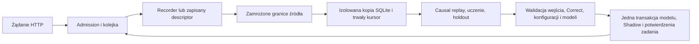

# Adaptive AI 0.15.16 TEST — poprawka spójności i wyniki treningu

## Status

**BLOCKED** jako kompletne zakończenie audytu i optymalizacji. Ten etap usuwa odtworzony konflikt FeatureJournal, poprawia zachowanie kolejki i dostarcza test ścieżki produkcyjnej. Współdzielenie niezmiennych danych po kilku agentach, trwałość wszystkich oczekujących pozycji i akceptacja obciążenia na Raspberry Pi 5 pozostają otwarte.

Zmiany rozwijano od `e2991ecdbf744572e0f80d9a3db74d55b789064e` na osobnym worktree. PR jest szkicem do gałęzi 0.15.15. [PR #379](https://github.com/mpuchara/HomeMind-HA/pull/379)

## Przyczyna i naprawa

- `FeatureJournal.open_window` masowo aktualizował `protected_until` starszych obserwacji. Na źródłowym SQLite trigger liczył zmianę jako mutację zbioru uczącego. Test z radarem kuchennym odtwarza znany komunikat na 0.15.15. Log instalacji pozwala potwierdzić tabelę i encję. Brakuje w nim informacji o instrukcji SQL, więc dokładny zapis, który spowodował incydent na Pi, pozostaje nieustalony.
- FeatureJournal miał niezależne czyszczenie wieku i limitu encji, które mogło usuwać aktywne wejście pomimo koordynacji retencji archiwum. Teraz oba mechanizmy honorują istniejącą ochronę nadzorowanego zadania. Twardy globalny limit i awaryjne zarządzanie przestrzenią nadal działają.
- Dla FeatureJournal walidator używa tego samego zbioru encji, rowid i zamkniętego przedziału czasu co kopia. Jedna pozycja na encję i agenta przechowuje pierwszą istotną operację. Triggery reagują na oba końce relokacji wiersza. Dopiski z rowid ponad granicą przynależą do następnego wejścia, także przy spóźnionym zdarzeniu. Usunięcie wiersza z wejścia, przeniesienie klucza do zakresu, zmiana receipt, jakości, źródła lub stanu nadal blokują publikację.
- Identyczna deduplikacja w FeatureJournal pomija UPDATE. Kontrolny batch 1 000 powtórzeń wywołał 1 000 aktualizacji na 0.15.15 i zero na 0.15.16. Poprawienie receipt lub jakości nadal zapisuje dane. Checkpoint ze starszą definicją triggera jest odrzucany zgodnie z walidacją manifestu. Źródło i zatwierdzone modele w bazie głównej pozostają dostępne dla nowej generacji.
- Kolejka zamyka wyczerpane retry SQLite. Pozostały przejściowy błąd miejsca może automatycznie wrócić do kolejki najwyżej raz na żądanie. Zapisany kursor replay jest opisany osobno od wyniku zadania. Profil potwierdza też ukończony Shadow z wstrzymanym Control. Jedna sesja emituje zdarzenie błędu oraz techniczną informację o zwolnieniu slotu.
- Potwierdzenie publikacji job ID zapisuje się w tej samej transakcji SQLite co model, doświadczenia i stan. Po restarcie zalegający deskryptor już zatwierdzonej generacji jest usuwany z kolejki. Cytowany w bazowym CI błąd ponownego otwarcia WAL odtworzono w teście, który zostawiał otwarte własne połączenia. Test obecnie sprawdza z niezależnego, jawnie zamkniętego czytnika rzeczywiście zatwierdzone wiersze w oknie, zatrzymuje proces i wymaga wznowienia oraz Shadow.
- W aktualizacji obserwacji `RoomBeliefModel.observe` tworzył odłączone diagnostyki każdego źródła i odrzucał je po obliczeniu prawdopodobieństwa. `observe` pomija ich materializację. Agregacja, czas dostępności, detekcja przejść i prognoza z diagnostyką zachowują dotychczasowy wynik. Test porównuje prognozy i checkpoint po opóźnionych zdarzeniach, przenosinach encji i utracie dostępności.

## Trening po zmianie

Pełna ścieżka i koszty poszczególnych etapów są opisane w [audycie](TRAINING_FULL_AUDIT_PL.md). Procesy sprawdzają dostępne zasoby systemu i ograniczenia cgroup. Historia zachowuje maksymalnie siedem dni oraz wcześniejsze seedy. W profilu normalnym podział wynosi 6 godzin, z ograniczonym overlapem i przeniesieniem stanu gdy działa stateful continuation. W wyniku braków recovery zaczyna od wspólnego, rzeczywistego punktu synchronizacji. Wnioski z benchmarku historycznej automatyzacji pozostają oddzielne od trafności preferencji mieszkańca. Ridge ocenia odłożone chronologicznie próbki przed ich końcowym złożeniem w politykę.

`GET /api/agents/{id}/training-diagnostics` zwraca raport JSON aktywnego lub ostatniego treningu w ograniczonej pamięci procesu. Raport zawiera dopuszczone liczniki i czasy, w tym osobny czas indeksowania i commitów checkpointu. Do raportu nie trafiają identyfikatory encji, stan urządzeń, ścieżki, daty zdarzeń, zawartość kursora ani traceback. Nieudostępnione liczniki pozostają nieznane. Ścieżka ma te same ograniczenia zaufanego klienta co żądania treningu. Odczyt korzysta wyłącznie z profilu w RAM.

## Wyniki hosta

Porównanie produkcyjnego workera 0.15.15 z `9dfc3f26` na tym samym zarchiwizowanym zestawie danych. Linux CI, Python 3.11, jeden pomiar każdego wariantu, baza 1 251 970 rekordów, z czego odczytano dwa strumienie wybranego agenta. Pomiary są sekundami czasu ściennego, o ile nie opisano ich inaczej. [Wynik porównania z CI](https://github.com/mpuchara/HomeMind-HA/actions/runs/44614495298/artifacts/14575360088)

| Metryka | 0.15.15 | 0.15.16 | Różnica |
| --- | ---: | ---: | ---: |
| Przygotowanie do końca budowy indeksów | 0,01830 s | 0,01812 s | −0,00018 s |
| Replay wraz z uczeniem wykonywanym w pętli | 2,719 s | 2,689 s | −0,031 s |
| Cały worker | 3,170 s | 3,008 s | −0,162 s |
| CPU całego workera | 2,578 s | 2,433 s | −0,145 s |
| Peak RSS | 69,21 MiB | 64,19 MiB | −5,02 MiB |
| Wiersze payloadu źródłowego | 964 | 964 | 0 |
| Logiczne bajty kopii historii | 111 840 B | 111 840 B | 0 |
| Zatwierdzone strony kopii historii | 2 | 2 | 0 |
| Ukończone treningi | 1 | 1 | 0 |

Hash uczonego modelu i wyniki holdoutu były identyczne. Czasy walidacji i nauki Ridge współdzielą pracę w replay. Fizyczne I/O i p95 HA pozostają niezmierzone w tej parze. Licznik stron pokrywa commity kopii historii. Różnice czasu w pojedynczej próbie pozostają niewystarczające do oszacowania przyspieszenia typowego domu.

Przypięta para dla Linuksa i Pythona 3.11 na commicie `62b74d00`, przed optymalizacją `RoomBeliefModel.observe`, daje 3,514 → 3,373 s czasu workera, 2,829 → 2,700 s CPU i 68,96 → 64,42 MiB peak RSS z `getrusage`. Replay zmienił się z 2,965 do 3,007 s. Odczytano po 964 wiersze. Hash modelu i holdout z obu akcji są identyczne. [Surowy wynik porównania z CI](https://github.com/mpuchara/HomeMind-HA/actions/runs/44611587268/artifacts/14574420962)

Test produkcyjnej ścieżki HTTP na Windows, Python 3.11 i 3.13, ukończył 3 zadania do Shadow. Drugie zadanie wystartowało ze slotu zwolnionego przez pierwsze. Trzecie wystartowało po restarcie i było równoczesne z zapisem archiwum, dopisywaniem dziennika oraz aktualizacją ochrony zamrożonej obserwacji. Modele miały 479, 480 i 480 doświadczeń oraz co najmniej 94 próbki benchmarku. Zapis każdego modelu i jego watermark odczytano z bazy. Wcześniejsze modele zachowały zawartość. Stub HA otrzymał zero wywołań sterujących.

Przy 12 odczytach loopback `/api/agents` podczas trzeciego zadania p50/p95/p99 wyniosły 18,74/25,89/25,89 ms na Pythonie 3.11 i 8,19/24,63/24,63 ms na 3.13. Mała próba sprawdza responsywność smoke. Rozkład opóźnień fizycznego websocketu HA i stabilność pod długotrwałym obciążeniem pozostają do zmierzenia.

Na dokładnym commicie pakietu trzy treningi w CI zapisały 479, 479 i 480 doświadczeń oraz po 94 próbki benchmarku na obu wersjach Pythona. Loopback p95 wyniósł 5,24 ms na 3.11 i 5,05 ms na 3.13 w tym samym krótkim scenariuszu. [E2E Python 3.11](https://github.com/mpuchara/HomeMind-HA/actions/runs/44614495298/artifacts/14574362053), [E2E Python 3.13](https://github.com/mpuchara/HomeMind-HA/actions/runs/44614495298/artifacts/14573987622)

Porównawczy scenariusz WAL z 1 000 syntetycznych zdarzeń i 3 agentami porównał 0.15.7 z `62b74d00`. Po stronie kandydata dotarło 3 000 oczekiwanych obserwacji i nie było wywołań HA. Engine ingress p50/p95/p99 wzrósł z 4,46/8,90/11,84 do 5,20/9,97/13,50 ms. Loopback HTTP p95 wzrósł z 333,67 do 533,37 ms. Warianty wykonały odpowiednio 16 i 53 cykle przygotowania, więc różnica obciążenia uniemożliwia przypisanie zmian do poprawki 0.15.16. [Surowy wynik WAL i ingress](https://github.com/mpuchara/HomeMind-HA/actions/runs/44611587268/artifacts/14573358108)

W pierwszym wariancie dużej próby, z 25 agentami i 240 encjami, przygotowanie dochodziło do `quick_check` w 64,0 s po skopiowaniu 2 141 176 rekordów historii. Faza do tego punktu zawierała 19,27 s commitów kursora i 9,53 s throttlingu. Pierwszy agent zapisał model i uzyskał Shadow, lecz asercja jakości zatrzymała próbę. Przy pustym rejestrze stref syntetyczne encje światła wyparły oczekiwany radar z ośmiu slotów. To scenariusz z brakującą topologią. Pomiar pierwszego zadania jest użyteczny, a taki wynik nie spełnia warunków jakości testu. Następny wariant dostarcza rejestr stref przez ten sam punkt wejścia co HA i nadal wymaga radaru oraz obu klas holdoutu.

W gęstym replay z topologią `RoomBeliefModel._fuse_room` wystąpiło w 892 z 1 498 próbek stosu workera, a `deepcopy` w 295. To liczniki profilu, które mogą się nakładać. Pomiar samego `observe` na 48 źródłach i 3 000 obserwacji, pięć naprzemiennych powtórzeń, dał medianę 0,552 → 0,396 s wall i 0,547 → 0,406 s CPU na hoście. Każda para zwróciła identyczny eksport modelu pokoju i prognozę. Skrócenie o około 28% dotyczy tej operacji.

Pierwszy gęsty trening z topologią wyznaczył punkt odniesienia przed optymalizacją `observe`. Worker osiągnął Shadow i zapisał 480 doświadczeń po 28 chunkach. Radar pozostał głównym sygnałem obecności. Holdout obejmował 58 próbek OFF i 57 ON. W tym fixture obie klasy zgadzały się z zapisanym zachowaniem. Raport z bazy oraz drugi startujący job potwierdziły atomową publikację i przekazanie slotu.

| Faza pierwszego gęstego zadania | Zmierzony koszt |
| --- | ---: |
| Odświeżenie Recorder ze stubem i gotowym archiwum | 2,47 s |
| Przygotowanie izolowanej kopii | 45,17 s |
| CPU przygotowania | 31,00 s |
| Indeksowanie, wliczone w przygotowanie | 10,33 s |
| Commity kursora, wliczone w przygotowanie | 1,87 s |
| Zatwierdzone obserwacje historii / strony | 2 141 176 / 4 282 |
| Replay z uczeniem w pętli | 1 117,95 s |
| Razem w 28 logicznych chunkach | 1 214,48 s |
| Cały nadzorowany worker | 1 260,42 s |

Drugi gęsty trening wykonał własną kopię 2 137 110 rekordów i dotarł do jej `quick_check` w 66,95 s. Po potwierdzeniu redundancji i zapisaniu pierwszego modelu zatrzymano dodatkową gęstą serię. Trzy zadania z testu minimalnego przeszły osobno na ostatnim kodzie. Dla scenariusza gęstego nadal potrzebna jest dopasowana para całych treningów przed i po zmianie. Próby z topologią i bez niej miały różne warunki danych i I/O, więc ich czas przygotowania dokumentuje rozrzut.

## Granice tego etapu

1. Pełne oczekujące wpisy kolejki są w pamięci procesu. Deskryptory chronią rozpoczęte lub odroczone przygotowanie. Trwałość kolejki przed wystartowaniem childa wymaga odrębnej implementacji z zachowaniem admission i Control.
2. Nadal powstaje osobna kopia historii dla każdego agenta. Scratch zawiera prywatne tabele Correct i modelu, więc ponowne użycie całej bazy jest nieodpowiednie. Następny pomiar powinien wskazać wspólny zestaw odczytów, które da się wersjonować niezależnie od stanu agentów. W recovery warto zmierzyć powtarzany `COUNT(DISTINCT entity_id)` na stabilnym `recovery_rows` dla kolejnych odcinków.
3. `entity_history` i provenance zawierają zależności seedów, więc używają szerszych granic. Dokładna walidacja metadanych po agentach, w tym rozdzielenie retry przy zmianie Correct od ponownego kopiowania archiwum, pozostaje otwarta.
4. Przypadek ON/OFF po wielu korektach, lineage Candidate, długotrwałe współdzielenie kontekstu i rzeczywiste HA wymagają reprezentatywnych danych oraz ponownego pomiaru. Efektywne opcje fizycznej instalacji nie były dostępne. Universal zachowuje ustawienia manifestu.

## Pakiet i test instalacyjny

Weryfikowany commit dodatku `9dfc3f26aa91a035a74436871074de126274278f`. CI zakończyło się sukcesem na Pythonie 3.11 i 3.13, po 3 312 testów na wersję. Przeszły obraz Docker, build i smoke ARM64 pod QEMU, gotowość dostarczonego entrypointu i manifesty ZIP. [GitHub Actions](https://github.com/mpuchara/HomeMind-HA/actions/runs/44614495298)

Pakiet testowy z CI zawiera wersję addon i repository oraz ich sumy SHA-256. Zweryfikowany addon ZIP z CI jest dostępny lokalnie w `dist/ci-9dfc3f26/HomeMind-HA-0.15.16-addon.zip`, SHA-256 `25e737d0f988d5b363676177685afb4a3ad0895f1d5e9174d6aa0da3cd47872a`. Artefakt GitHub jest dostępny do 3.12.2026. [Pobierz pakiet testowy z CI](https://github.com/mpuchara/HomeMind-HA/actions/runs/44614495298/artifacts/14576785041)

Lokalnie zweryfikowano ZIP dodatku z tego commita, jego manifest, wersję oraz wszystkie hashe pakietu. Plik to `dist/HomeMind-HA-0.15.16-addon.zip`, SHA-256 `9b0e07192ee181dfed1a02d06ed5a5017aa42640143274491f474ca8d9f04c64`. Migracja rzeczywistej bazy fixture 0.15.15 zachowała stan i czas odbioru obserwacji. Wersja 0.15.16 odrzuciła stary checkpoint i poprawnie zweryfikowała nowo zarejestrowane okno po operacji ochrony.

Po dopuszczeniu do testu wykonaj pełny backup danych dodatku. Dla lokalnej instalacji zastąp pliki źródłowe dodatku zawartością addon ZIP, zachowując katalog danych i lokalizację instalacji. Odśwież listę dodatków i przebuduj obraz. Po uruchomieniu sprawdź wersję 0.15.16 i gotowość pod `/health`, porównaj zachowane modele, następnie uruchom pojedynczy trening i sprawdź zapis modelu oraz Shadow. Osobno sprawdź kolejny wpis kolejki i pobierz raport timingów. Przy powrocie do 0.15.15 zatrzymaj dodatek, zachowaj oddzielną kopię danych z testu i przywróć wersję razem z backupem danych sprzed aktualizacji. Kod 0.15.15 oczekuje poprzednich definicji triggerów, więc cofnięcie samego obrazu może zatrzymać start dodatku.
